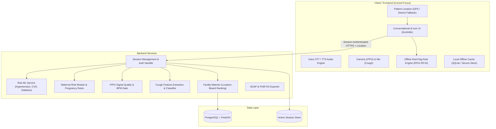
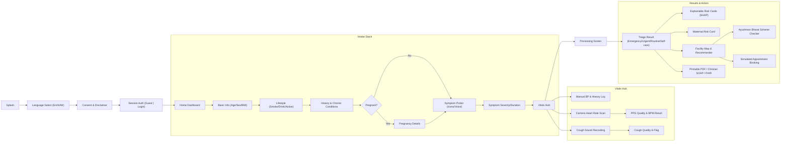

# Swasthik: Comprehensive Project Specification & System Blueprint

> **Notice for AI Agents and Developers**:  
> Read this document thoroughly before contributing code or design assets.  
> **Current Sprint Objective**: Frontend Development & UI/UX workflows.  
> **Tech Stack Note**: The proposed technology stack is **indicative/provisional** and subject to adjustments by the team. Keep code modular, clean, and easily configurable.

---

## 1. Executive Overview

* **Product Name**: Swasthik (Prometheus Healthcare)
* **Tagline**: *Check early. Reach care faster.*
* **Target Audience**: Rural and semi-urban Indian populations with limited digital and medical literacy, ASHA workers, and Primary Health Centre (PHC) medical officers.
* **Core Languages**: English, Hindi (`hi`), Marathi (`mr`).
* **Mission**: A preventive triage and health navigation application that identifies early health risks (hypertension, diabetes, CVD, maternal risk), detects red-flag emergencies, checks non-invasive smartphone vitals (camera heart rate, cough screening), and routes users to the nearest appropriate healthcare facility.
* **Medical Disclaimer**: Swasthik provides **triage and risk screening guidance only**, not medical diagnoses. It does not prescribe medications.

---

## 2. Key Architecture Directives & Modifications

The standard architecture incorporates two vital requirements:

1. **Patient Location Integration**:
   - Patient geolocation (latitude/longitude via device GPS or manual district selection fallback) is tracked across the intake and facility recommender pipeline.
   - It directly drives the facility ranking algorithm (PostGIS / Haversine) to match patients to nearby PHCs, CHCs, maternity centers, and PM-JAY empanelled hospitals.
   - Offline mode defaults to a cached facility directory for the user's selected district.

2. **Session-Based Authentication (Replacing JWT)**:
   - In place of stateless Supabase JWTs, authentication uses **server-managed sessions** (session tokens/cookies stored securely on client, verified against active server session store).
   - Guest accounts generate a persistent guest session token stored in local secure storage, which can later be upgraded to a registered account without losing assessment history.

---

## 3. Technology Stack (Tentative / Subject to Team Finalization)

> The engineering team may revise specific packages or frameworks. Ensure all components and state models remain decoupled.

| Layer | Proposed / Baseline Technologies | Notes |
| :--- | :--- | :--- |
| **Mobile / Frontend** | React Native with Expo (TypeScript) | Alternative web-first prototype may use React/Next.js/Vite depending on team agreement. |
| **State Management** | Zustand (Client State), TanStack Query (Server State) | Clean separation of form intake, offline queues, and fetched data. |
| **Localization (i18n)** | `i18next` with `en.json`, `hi.json`, `mr.json` | Every user prompt and text element must be externalized. |
| **Voice & Accessibility** | Android SpeechRecognizer (`@react-native-voice/voice`), `expo-speech` | Fallback audio clips for Marathi / regional voices. Large 48dp+ touch targets. |
| **Location & Maps** | `expo-location`, Leaflet in WebView (OpenStreetMap tiles - no API key dependency) or native map | Requires graceful handling of denied permissions. |
| **Local Storage** | `expo-sqlite`, `expo-secure-store` | Offline assessment draft caching, session tokens, offline red flags. |
| **Backend** | Python 3.11, FastAPI, Pydantic, Uvicorn | High-throughput asynchronous endpoints. |
| **Database** | PostgreSQL with PostGIS extension | Spatial queries (`ST_DWithin`, `ST_Distance`) for hospital routing. |
| **ML & Signal Processing** | `scikit-learn`, `xgboost`, `shap`, `opencv-python`, `mediapipe`, `librosa`, `scipy` | Run server-side; videos/audio streams deleted immediately after processing. |

---

## 4. Emergency Red-Flag Rule Engine (On-Device, Offline)

The red-flag engine is the critical safety layer. It runs **fully offline** on the device immediately after each input and on final submission. If any condition triggers, the app displays a full-screen **Emergency Alert** with direct 1-tap call to **108** and hospital navigation.

| Rule ID | Condition Description | Clinical Focus |
| :--- | :--- | :--- |
| **RF01** | Chest pain or pressure accompanied by sweating, nausea, arm/jaw pain, or breathlessness | Acute Coronary Syndrome |
| **RF02** | Systolic BP $\ge$ 180 mmHg or Diastolic BP $\ge$ 120 mmHg | Hypertensive Crisis |
| **RF03** | Sudden unilateral weakness, facial drooping, slurred speech, or acute vision loss | Stroke Symptoms |
| **RF04** | Severe breathlessness at rest | Respiratory Distress |
| **RF05** | Pregnancy with vaginal bleeding, severe headache + blurred vision, convulsions, reduced fetal movement, or BP $\ge$ 160/110 | Pre-eclampsia / Obstetric Emergency |
| **RF06** | Fainting, syncope, or loss of consciousness | Hemodynamic / Neuro Shock |
| **RF07** | Diabetic with confusion, extreme drowsiness, fruity breath, or persistent vomiting | Diabetic Ketoacidosis (DKA) |
| **RF08** | Measured heart rate > 150 BPM or < 40 BPM at rest with symptoms (PPG quality must be Good) | Severe Arrhythmia |
| **RF09** | Coughing blood (hemoptysis) | Pulmonary Emergency |
| **RF10** | Active seizure or convulsions | Neurological Emergency |

---

## 5. Machine Learning Models Overview

The system incorporates 6 distinct ML components:

1. **Hypertension Risk Classifier**:
   - Binary risk with 3 bands (Low, Medium, High).
   - XGBoost baseline. "No BP" model for intake and "With BP" model for logged vitals.
   - Returns probability, risk band, and top 3 SHAP contributing factors in plain language.
2. **Cardiovascular Disease (CVD) Risk**:
   - Features: Age, sex, BMI, BP, smoking, physical activity, diabetes status, symptoms.
   - Trained on Kaggle CVD (70k) / Framingham baseline. Output: Risk band + SHAP factors.
3. **Diabetes Risk**:
   - Features: Lifestyle-based BRFSS indicators (no lab values required).
   - Cross-checked with Indian Diabetes Risk Score (IDRS).
4. **Maternal Risk Classifier**:
   - 3-class (Low, Mid, High). Active only if user is pregnant.
   - Features: Age, systolic/diastolic BP, heart rate, optional blood glucose/body temperature.
   - High risk triggers Urgent triage and filters facility search to maternity centers.
5. **rPPG Signal Quality Gate (Model 5)**:
   - 3-class classifier: **Good, Marginal, Poor**.
   - Input: 10-second face video windows (MediaPipe face landmarks ROI: forehead & cheeks).
   - Extracts spectral features (SNR, power ratio) and time-domain features.
   - Only Good/Marginal windows compute BPM. Poor windows trigger clear retry guidance (lighting, movement).
6. **Cough Audio Classifier (Model 6)**:
   - Input: 10-second audio recording (16 kHz mono).
   - Pipeline: SNR check $\rightarrow$ energy segmentation (coughs detected) $\rightarrow$ MFCC feature extraction $\rightarrow$ XGBoost classifier.
   - Output: Normal-like vs Abnormal-like. **Supporting signal only** (never causes emergency alone).

---

## 6. Frontend Screen Inventory (32 Screens / Views)

As our immediate focus is the **Frontend**, all user interfaces should be designed according to this navigation architecture:

### Complete Screen Directory

1. **Splash Screen**: Brand identity, offline check.
2. **Language Selection**: Visual cards for English, हिंदी, and मराठी.
3. **Consent & Medical Disclaimer**: Clear declaration that app is a triage assistant, not a diagnosis.
4. **Auth / Guest Screen**: Instant 1-tap "Continue as Guest" or mobile/email login.
5. **Home Dashboard**: Start health check, view recent vitals, emergency SOS button.
6. **Intake - Basic Info**: Age, sex, height, weight (with automatic BMI calculation).
7. **Intake - Lifestyle**: Smoking, alcohol, physical activity level.
8. **Intake - History**: Known conditions (hypertension, diabetes, heart), family history.
9. **Intake - Pregnancy Details**: (Conditional) Gestational weeks, gravida, prior complications.
10. **Intake - Symptoms Grid**: Large touch cards with icons (chest pain, fever, cough, etc.) + voice input.
11. **Intake - Symptom Details**: Duration in days and severity selector (1–3).
12. **Emergency Alert (Overlay)**: Immediate full-screen trigger with 108 dialer and facility map.
13. **Vitals Hub**: Gateway to BP log, camera scan, and cough recorder.
14. **BP Entry & Log**: Numeric systolic/diastolic input with history trend chart.
15. **Heart Rate Scan (rPPG)**: Live camera view, face oval guide, real-time lighting/motion tips.
16. **Heart Rate Result**: BPM with Quality Badge (Good/Marginal) or retry instructions if Poor.
17. **Cough Audio Recorder**: 10-second countdown, microphone audio level meter.
18. **Cough Result**: Normal-like vs Abnormal-like flag with confidence and audio quality status.
19. **Processing Screen**: Engaging animation while evaluating rules and models.
20. **Triage Summary**: Clear color badge (Red: Emergency, Orange: Urgent, Yellow: Routine, Green: Self-care).
21. **Risk Cards & Explanations**: Plain-language top contributing factors (SHAP explanations).
22. **Maternal Risk Details**: Specialized obstetric risk card with rule overrides.
23. **Facility Recommender (Map & List)**: Geolocation-sorted PHCs/CHCs/Hospitals with distance and status.
24. **Facility Details**: Operating hours, phone dialer, Ayushman Bharat badge, services offered.
25. **Scheme Eligibility Check**: Short questionnaire for PM-JAY eligibility and required documents.
26. **Simulated Appointment Booking**: Facility slot picker, reference code confirmation screen.
27. **Patient Summary Preview**: One-page printable PDF preview with sharing capabilities.
28. **Clinician SOAP View**: Subjective, Objective, Assessment, and Plan structured summary.
29. **FHIR R4 JSON Export**: View and copy/export FHIR standard bundle.
30. **Assessment History**: Historical record of previous screenings and vital trends.
31. **Settings**: Language switch, session management, data deletion ("Right to be Forgotten").
32. **Model Transparency Cards**: Inspection screen listing all 6 model versions, metrics, and limitations.

---

## 7. UI/UX Design Guidelines for Frontend Development

1. **Low-Literacy & High Accessibility**:
   - Minimum tap target of **48 dp** for all interactive elements.
   - Every input prompt must have an accompanied icon and Text-to-Speech audio prompt.
   - High contrast colors compliant with WCAG AA standards.
2. **Color Hierarchy**:
   - 🔴 **Emergency**: Crimson Red (`#DC2626`)
   - 🟠 **Urgent**: Deep Orange (`#EA580C`)
   - 🟡 **Routine**: Amber/Yellow (`#D97706`)
   - 🟢 **Self-care**: Emerald Green (`#059669`)
   - Never rely solely on color: always pair with unambiguous iconography and multilingual labels.
3. **No Dead Ends**:
   - If location access is denied $\rightarrow$ show simple district dropdown.
   - If camera or microphone fails $\rightarrow$ allow manual vital entry or skip option.
   - If offline $\rightarrow$ save locally and display "Saved offline - will sync when connected" toast.

---

## 8. Frontend Engineering Directives for Agents

When generating frontend code:
- Maintain clean, componentized architecture (atomic components, organized views, modular screens).
- Provide centralized localization hooks (`useTranslation` or equivalent dictionary pattern).
- Mock service adapters cleanly so the frontend works smoothly both with mock data and real backend APIs.
- Keep session tokens and user location stored in an abstracted state/storage module for seamless swap when the backend session protocol is finalized.
