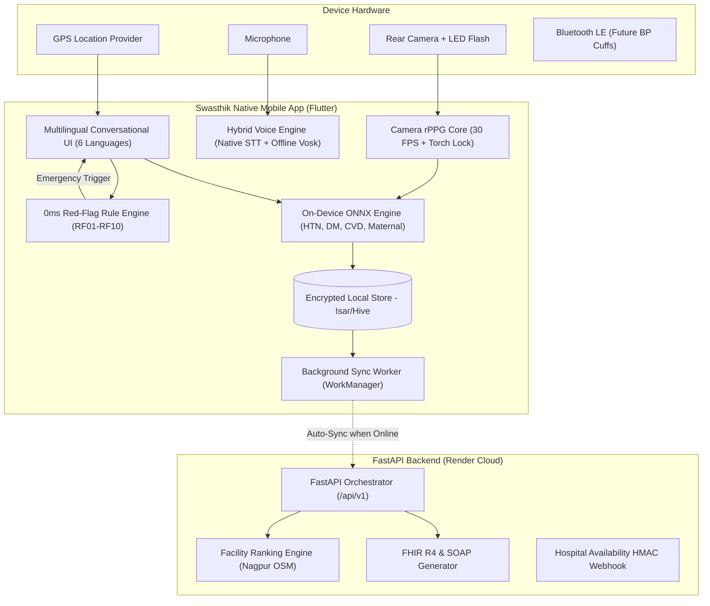

# 📱 Swasthik Mobile Architecture & Implementation Blueprint
> **AI-Powered Early Health Risk Detection & Healthcare Access Navigation**  
> Target Platform: **Android (Primary - Android 8.0+) & iOS**  
> Target Users: Rural/Semi-Urban Citizens, ASHA Workers, Community Health Officers (CHOs)

---

## 1. Executive Summary & Mobile Vision

While the web app (PWA) delivers rapid triage accessible via any browser, the **Swasthik Mobile Native App** provides true device integration essential for Bharat's ground reality:
1. **Raw Camera Hardware Control for rPPG**: Full 30/60 FPS lock, fixed exposure, white balance lock, and hardware LED flashlight (torch) control for accurate photoplethysmography heart rate screening.
2. **100% On-Device ML Inference (Zero-Latency & Offline)**: Compiling our LightGBM & Random Forest bundles to **ONNX Mobile / TFLite** so chronic disease prediction and SHAP explanations execute without any cellular data connection.
3. **Background Sync Engine via WorkManager**: Automatically syncing stored triage records with the cloud FastAPI backend whenever the phone connects to 2G/3G/4G/Wi-Fi.
4. **ASHA / Field Worker Mode**: Multi-patient household surveys, bulk screening, ABHA QR-code scanning, and Bluetooth LE digital BP monitor integration.

---

## 2. Recommended Tech Stack

| Layer | Technology | Rationale |
|---|---|---|
| **Framework** | **Flutter 3.x (Dart)** | Direct 60 FPS UI rendering, low memory footprint on budget ₹6,000–₹10,000 Android phones (Redmi/Realme/Samsung A-series), seamless camera stream access via platform channels. |
| **State Management** | **Bloc / Riverpod** | Predictable, testable reactive state management for multi-step intake and emergency state locks. |
| **Local Database** | **Isar / Hive + SQLCipher** | Ultra-fast NoSQL/relational embedded database for offline assessments, patient history, and cached district hospital directories with AES-256 encryption. |
| **On-Device ML** | **ONNX Runtime Mobile (`onnxruntime`)** | High-performance inference for converted LightGBM (HTN, DM, CVD) and Random Forest (Maternal) models directly in C++/Dart without Python. |
| **Camera & Sensors** | `camera` + `torch_light` | Stream YUV420/RGB raw bytes from rear sensor at locked 30 FPS with torch on for rPPG vital detection. |
| **Voice & Audio** | Native SpeechRecognizer + Vosk / Gemini API | Hybrid voice recognition: Offline Vosk model for local Hindi/Marathi commands; Gemini 2.5 Flash via REST API when online. |
| **Maps & Routing** | `flutter_map` (OpenStreetMap) | Fully open-source, offline tile-caching capabilities, zero Google Maps API licensing costs. |
| **Background Sync** | `workmanager` | Guaranteed background tasks that sync queued offline assessments to `POST /api/v1/assess` when network restores. |

---

## 3. Core System Architecture



---

## 4. Phase-by-Phase Mobile Implementation Roadmap

### 🏁 Phase 1: Foundation & Multilingual Shell (Sprint 1)
- [ ] Initialize Flutter project with clean architecture (`lib/core`, `lib/features`, `lib/data`).
- [ ] Set up design system: Palette (`#2F404F` Ink, `#3894A1` Teal, `#F0F1EE` Paper, `#C7DAD3` Mint, `#B42318` Emergency Red).
- [ ] Localization framework (`easy_localization` or Flutter i18n) supporting **English, Hindi, Marathi, Gujarati, Telugu, Kannada**.
- [ ] Implement Session Manager (storing secure session tokens, guest UUIDs in `flutter_secure_storage`).
- [ ] Build Home, Language Selection, and Medical Disclaimer screens.

### 🚨 Phase 2: Deterministic Safety Engine & Intake Wizard (Sprint 2)
- [ ] Port **RF01–RF10 Red-Flag Engine** into pure Dart (`red_flag_engine.dart`):
  - Sub-millisecond evaluation on every symptom toggle.
  - Emergency overlay modal with instant `Call 108` native intent dialer.
- [ ] Conversational Multimodal Intake Wizard:
  - Big icon cards for 28 symptoms.
  - Native microphone integration with pulsating visual recording wave.
  - Step-by-step navigation (Basic Demographics, Lifestyle, Medical History, Pregnancy Module, Symptoms, Vitals).

### 📷 Phase 3: Hardware rPPG & On-Device ML Inference (Sprint 3)
- [ ] **Camera rPPG Engine**:
  - Lock rear camera at fixed frame rate (30 FPS), fixed exposure, fixed focus.
  - Enable hardware torch.
  - ImageStream listener extracting average Green-channel intensity per frame across a circular fingertip ROI (Region of Interest).
  - Native FFT algorithm in Dart to detect peak pulse frequency (0.75 Hz – 3.5 Hz).
  - Signal quality gate rejecting cold fingers or excessive motion.
- [ ] **Convert & Package Models**:
  - Convert `htn_bundle.joblib`, `dm_bundle.joblib`, `cvd_nolab_bundle.joblib`, and `maternal_bundle.joblib` to ONNX format.
  - Run inferences locally on device using `onnxruntime_flutter`.
  - Port TreeSHAP feature weight calculation for top-3 multilingual explanation generation.

### 🗺️ Phase 4: Facility Routing, Maps & Government Schemes (Sprint 4)
- [ ] Geolocation service fetching coordinates via `geolocator` with district picker fallback (default Nagpur).
- [ ] Offline hospital directory bundled in SQLite asset (GMCH, Mayo, AIIMS, Daga, Orange City).
- [ ] OpenStreetMap view with custom medical pins, distance calculation (Haversine), and estimated transit times.
- [ ] Direct dialer links (`tel:`) for hospital emergency desks and ambulance 108.
- [ ] Interactive **Ayushman Bharat (PM-JAY)** eligibility questionnaire module.

### 🩺 Phase 5: Clinician Mode & ASHA Field Tools (Sprint 5)
- [ ] **Clinician SOAP Note View**: Subjective, Objective, Assessment, Plan generated on-screen with native PDF export/print (`pdf` & `printing` packages).
- [ ] **HL7 FHIR R4 JSON Exporter**: Generate standard clinical JSON bundle ready for ABHA / hospital EMR sharing via Android Share Sheet (WhatsApp, Email, Bluetooth).
- [ ] **ASHA Community Mode**:
  - Multi-profile switcher (survey multiple families in a village offline).
  - High-risk pregnant women registry with reminder alerts for ANC visits.

### 🚀 Phase 6: Performance Optimization & Play Store Release (Sprint 6)
- [ ] ProGuard & R8 code shrinking (target APK size < 20 MB for 2G rural downloads).
- [ ] Battery & CPU optimization during camera rPPG scan (auto torch shutoff after 25 seconds).
- [ ] End-to-end integration testing on Android 8, 10, 12, 14 devices.
- [ ] Fastlane CI/CD pipeline for Google Play Store internal testing track.

---

## 5. Mobile Directory Structure (`mobile/`)

```
mobile/
├── android/                   # Native Android configuration & permissions
├── ios/                       # Native iOS configuration
├── assets/
│   ├── models/                # Converted ONNX clinical risk models
│   │   ├── htn_model.onnx
│   │   ├── dm_model.onnx
│   │   ├── cvd_model.onnx
│   │   └── maternal_model.onnx
│   ├── data/
│   │   └── facilities_nagpur.json   # Offline hospital fallback registry
│   ├── i18n/                  # Translation JSONs (en, hi, mr, etc.)
│   └── images/                # Medical icons & brand assets
├── lib/
│   ├── main.dart              # App entry point & initialization
│   ├── core/
│   │   ├── constants/         # Palette, Red-flag rules, thresholds
│   │   ├── theme/             # Material 3 custom Swasthik theme
│   │   └── network/           # Dio HTTP client, offline interceptors
│   ├── data/
│   │   ├── database/          # Isar/Hive local storage models
│   │   ├── repositories/      # Assessment, facility & sync repositories
│   │   └── sync/              # WorkManager background sync workers
│   ├── domain/
│   │   ├── models/            # PatientFeatures, TriageLevel, RedFlagRule
│   │   └── ml/                # OnnxInferenceService, ShapExplainer
│   ├── features/
│   │   ├── home/              # Welcome screen, health history, language
│   │   ├── intake/            # Multimodal step-by-step health check
│   │   ├── rppg/              # Camera vital scanner (Pulse & Signal Quality)
│   │   ├── emergency/         # High-priority Red-Flag emergency overlay
│   │   ├── results/           # Triage level, risk scorecards, SHAP cards
│   │   ├── facilities/        # OSM Leaflet map & facility recommendations
│   │   ├── schemes/           # PM-JAY Ayushman Bharat eligibility
│   │   └── clinician/         # SOAP note view & FHIR R4 JSON export
│   └── device/
│       ├── camera_controller.dart  # Raw frame stream & torch manager
│       ├── geolocation_service.dart # GPS position provider
│       └── speech_service.dart     # Native speech-to-text listener
├── test/                      # Unit & clinical rule evaluation tests
├── pubspec.yaml               # Flutter dependencies
└── mobile.md                  # This comprehensive architectural plan
```

---

## 6. Real-World Edge Cases & Mitigations in Rural Bharat

| Challenge | Root Cause | Mobile Native Mitigation |
|---|---|---|
| **Zero Internet in remote villages** | No cell towers in tribal/rural pockets | App executes **all triage rules and ONNX ML models 100% locally**. Assessments are stored in encrypted Isar DB and synced via `WorkManager` when connectivity returns. |
| **Budget Android Phones (2GB RAM)** | High memory usage causes OS to kill the app | Camera rPPG runs in a separate Dart `Isolate` and disposes frame buffers immediately. Models are quantized (INT8) to under 2MB each. |
| **Camera Lens Scratches & Cold Fingers** | Dust or poor blood circulation distorts rPPG signal | BUT-PPG trained quality classifier checks the signal before computing BPM. If SNR (signal-to-noise ratio) is low, app advises warming hands or gentle pressure. |
| **Low Digital & Reading Literacy** | Patient cannot read English or clinical terms | App features **Read Aloud TTS** on every question, 28 visual iconography cards, and voice input in Hindi/Marathi. |
| **Doctor Hesitation / Legal Safety** | Fear of AI giving incorrect diagnosis | App strictly enforces triage classification (*"Screening guidance, not a diagnosis"*), never prescribes drugs, and provides instant **FHIR R4 / SOAP export** so the doctor remains the decision-maker. |

---

## 7. Next Actions to Kick Off Mobile Development

1. Run `flutter create --org com.prometheus.swasthik mobile` inside the root workspace.
2. Add dependencies (`camera`, `onnxruntime`, `geolocator`, `flutter_map`, `speech_to_text`, `isar`).
3. Port `red_flag_engine.dart` and verify all 10 emergency rules against test fixtures.
4. Export the existing 4 scikit-learn/LightGBM models to ONNX runtime bundles.
